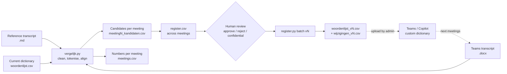

# Transcript dictionary evaluator

A small local tool that finds which words Microsoft Teams gets wrong in meeting transcripts, so you can add them to a custom dictionary, and then measures whether the dictionary helps.

## The problem

Teams transcription does well on everyday speech but stumbles on jargon: product names, internal abbreviations, people's names, and Dutch/English mixes. "Orbitly" becomes "Orbit Lee", "NWL" becomes "NWO". The fix this tool supports is a custom dictionary that an admin uploads: a CSV with a term and how it tends to be misheard ("sounds like"). The CSV columns in `examples/woordenlijst.csv` follow that upload format.

The hard part is not the upload. It is knowing which words to put on the list, and whether a new version of the list actually reduces errors. Guessing produces a list of words people think are hard, which is not the same as the words Teams gets wrong.

## What I built

Two Python scripts that compare a reference transcript with the Teams transcript of the same meeting.

- `vergelijk.py` reads a reference transcript (a HappyScribe Markdown export, corrected by hand) and the Teams transcript (.docx). It strips timestamps and speaker labels, aligns the two word sequences, and writes every difference that is likely a term to a candidate CSV. Each candidate gets a type (different word, space/hyphen, missing in Teams, capitalisation), a sound-alike score, a proper-noun/abbreviation flag, and whether it is already on the current list.
- `register.py` keeps one register of candidates across all meetings. A person reviews it (approve, reject, doubt, mark as confidential). `register.py batch v2` turns approved candidates into a new dictionary version and a change list. After a version is sent, the register counts how often a listed term is still transcribed wrong.

Every run also adds one row per meeting to `meetings.csv`, so you can follow the numbers over list versions.



## Design choices

- **Local only.** Transcripts contain what people said in meetings. Both scripts use the Python standard library (`difflib`, `zipfile`, `csv`) and send nothing to an external service. The .docx is read as a zip file; no Office install needed. The status note (`stand.md`) only receives counts and approved terms, and confidential terms show as `[vertrouwelijk]`.
- **Noise filtering.** Most differences between two transcripts are not dictionary problems. The script drops a difference when the reference side is only stopwords (Dutch and English filler and function words), only digits, or longer than 5 words (usually a misaligned stretch). Space/hyphen differences on ordinary words (`kick-off` vs `kick off`) are dropped, but kept for proper nouns and for terms already on the list. Capitalisation differences only count for proper nouns and abbreviations.
- **Ranking for review.** Candidates are sorted so that likely terms come first: proper noun or abbreviation, then frequency, then how similar the Teams version sounds.
- **Register across meetings.** One meeting is too small to decide anything. The register merges candidates per term, counts meetings and occurrences, merges the Teams variants into a "sounds like" proposal, and skips variants the list already contains. Running the same meeting twice does not double count.
- **Human review step.** The script proposes; a person decides. Some candidates are noise that got through the filter (`then` vs `so`), some are reference errors, some are names that should not go on a shared list without a check. The batch command only takes rows with status `goedgekeurd` (approved).
- **Measuring the effect.** After a version is sent, the register counts "seen after sending" per term, and `meetings.csv` records "on list and still wrong" and "variant already known and still wrong" per meeting. That is the evaluation signal: does the error rate on listed terms go down after a new version is live?

## Error taxonomy

| Type (`soort verschil`) | Example | Usually means |
| --- | --- | --- |
| `ander woord` (different word) | Orbitly -> Orbit Lee | Unknown term, good dictionary candidate |
| `spatie/streepje` (space/hyphen) | DataVlinder -> data vlinder | Term split into parts; candidate if it is a name |
| `ontbreekt in Teams` (missing) | SnelSync -> (nothing) | Dropped word; check audio quality first |
| `hoofdletters` (capitalisation) | SnelSync -> snelsync | Recognised but not as a name; minor |

## How to run

Python 3.10 or newer.

```bash
pip install -r requirements.txt

# compare one meeting (uses woordenlijst.csv next to the scripts by default)
python vergelijk.py meeting.md meeting.docx --meeting team-sync-1 --datum 2026-03-02

# review register.csv in Excel, then:
python register.py batch v2 --proef   # dry run
python register.py batch v2           # write woordenlijst_v2.csv and wijzigingen_v2.csv
python register.py stand              # counts per status

# rebuild the fictional examples and run the whole flow into examples/output/
python examples/make_examples.py
python examples/run_demo.py

python -m pytest
```

Set `WOORDENBOEK_MAP` to keep the register and lists in another folder. `--debug` writes the cleaned texts, which helps when the match score is low.

## Example output

`examples/run_demo.py` runs three fictional meetings. Meetings 1 and 2 use list v1 (3 terms). After meeting 2 the demo approves 5 candidates, rejects 2 and marks 2 as doubt, and builds v2 (8 terms). Meeting 3 runs against v2.

| Meeting | List | Words (reference) | Words (Teams) | Match | Candidates | Proper noun/abbr. | On list and still wrong | Known variant and still wrong | New in register |
| --- | --- | --- | --- | --- | --- | --- | --- | --- | --- |
| meeting1 | v1 | 85 | 98 | 81% | 9 | 7 | 2 | 1 | 9 |
| meeting2 | v1 | 66 | 79 | 80% | 7 | 7 | 2 | 2 | 1 |
| meeting3 | v2 | 55 | 65 | 80% | 6 | 5 | 5 | 4 | 1 |

Candidates for meeting 1 (`examples/output/meeting1_kandidaten.csv`, first columns):

| Candidate (reference) | Teams wrote | Type | Similarity | Proper noun/abbr. | On list |
| --- | --- | --- | --- | --- | --- |
| Fluxgrid | flux grid (2x) | spatie/streepje | 1.0 | ja | ja |
| DataVlinder | data vlinder (1x) | spatie/streepje | 1.0 | ja | |
| Orbitly | Orbit Lee (1x) | ander woord | 0.8 | ja | |
| SnelSync | snel sink (1x) | ander woord | 0.75 | ja | |
| Labs | Lapse (1x) | ander woord | 0.67 | ja | ja |
| NWL | NWO (1x) | ander woord | 0.67 | ja | |
| Ravi | Robbie (1x) | ander woord | 0.4 | ja | |
| churnmodel | turn model (1x) | ander woord | 0.84 | | |
| then | so (1x) | ander woord | 0.0 | | |

Filtered out in the same meeting: `kick-off` vs `kick off` (hyphen on an ordinary word), an extra "eh" in Teams (insertion only), and a title and date line that only exist in the .docx.

How to read this: the Teams transcripts in `examples/` are written by hand, so the meeting 3 numbers say nothing about whether a real dictionary works. They show what the tool reports. In this run 5 terms were sent in v2 and 3 of them (SnelSync, DataVlinder, Ravi) were still wrong in meeting 3; on real data that is exactly the signal to look at. The run also shows a limitation: in meeting 3, `NWL lakehouse` came out as one two-word candidate because two neighbouring words were both wrong.

All files from the run are in `examples/output/`: per-meeting candidates, `register.csv`, `meetings.csv`, `woordenlijst_v2.csv`, `wijzigingen_v2.csv` and `stand.md`.

## Tests

`python -m pytest`: **25 passed** (pytest 9.1.1, Python 3.12). The tests cover transcript cleaning, tokenising, the diff and its types, stopword and digit filtering, the length limit, proper noun detection, reading the dictionary CSV, merging candidates into the register across meetings, not double counting a rerun, counting errors after a version is sent, the meeting log, building a new list version, and one end-to-end run of `vergelijk.py` on `examples/meeting1`.

## What was replaced for privacy

This started as a tool for real meetings at work. For this public version:

- All meetings, transcripts, the register, the meeting log and the real word list are left out. `examples/` holds three made-up meetings at a made-up company, Northwind Labs, with made-up products (Fluxgrid, Orbitly, SnelSync, DataVlinder, NWL) and made-up speakers.
- Example names in code comments were replaced with fictional ones. The person who uploads the list is now "de beheerder" (the admin).
- The status note used to live at a fixed path in a personal notes folder. It is now `stand.md` next to the register, or any path in `WOORDENBOEK_NOTITIE`, and it is only updated if the file exists.
- The starting list version is `v1` instead of the version the real project was on.

The logic itself is unchanged.

## Language

Code comments, variable names, CSV column names and console output are in Dutch, because the tool was built for a Dutch team. This README is in English.

## License

MIT, see [LICENSE](LICENSE).
